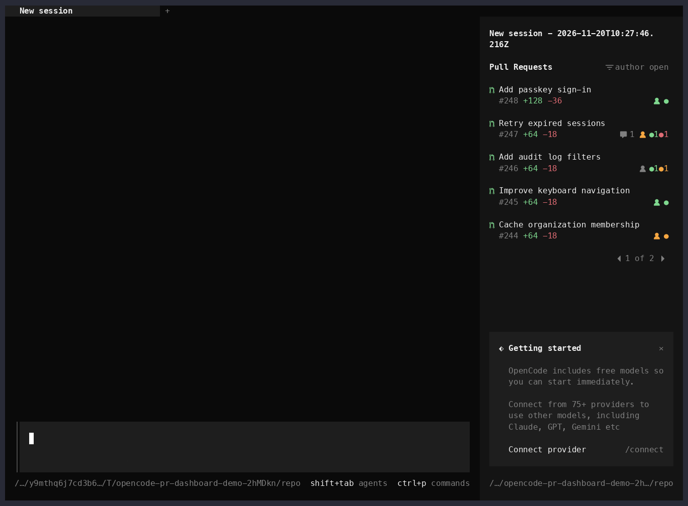

# opencode-github-pr

OpenCode V2 plugin providing a TUI sidebar dashboard for GitHub pull requests.



## Plugin parts

- `plugins/pr-dashboard.ts` — server part: plugin registration.
- `plugins/pr-dashboard.tui.tsx` — TUI part: PR list, CI/review status, slash commands, and refresh-on-idle.
- `plugins/` — shared GitHub data loaders, domain logic, and Solid UI components.
- `tests/` — unit, integration, and TUI end-to-end tests.

The package exports both parts via `package.json`; OpenCode V2 loads them together as one plugin.

## Customize the dashboard

Set plugin options in the plugin entry's `options` object. The following example shows every configurable color and icon:

```json
{
  "plugins": [
    {
      "package": "/absolute/path/to/opencode-github-pr",
      "options": {
        "enabled": true,
        "pageSize": 8,
        "maxPRPages": 3,
        "refreshIntervalMs": 30000,
        "requestTimeoutMs": 15000,
        "defaultScope": "author",
        "defaultStatusFilter": "open",
        "colors": {
          "panel": "#161616",
          "panelAlt": "#1d1d1d",
          "border": "#3a3a3a",
          "borderActive": "#5f87ff",
          "text": "#e5e5e5",
          "muted": "#888888",
          "accent": "#5f87ff",
          "success": "#5fbf5f",
          "warning": "#d8a657",
          "error": "#d86565",
          "draft": "#888888",
          "merged": "#a371f7"
        },
        "icons": {
          "openPR": "",
          "mergedPR": "",
          "review": "",
          "openComment": "󰅺",
          "check": "●",
          "scope": "",
          "status": "",
          "loading": "󰔟",
          "info": "",
          "error": "",
          "previousPage": "",
          "nextPage": ""
        }
      }
    }
  ]
}
```

`pageSize`, `maxPRPages`, `refreshIntervalMs`, and `requestTimeoutMs` must be positive numbers. `defaultScope` accepts
`branch`, `author`, `assignee`, or `all`; `defaultStatusFilter` accepts `open`, `closed`, or `all`. Colors can be any
OpenTUI-supported color string. Icons accept any non-empty string, so plain ASCII glyphs work in terminals without a
Nerd Font. Unspecified colors use the active OpenCode theme; unspecified icons and options retain their defaults.

## Run a local OpenCode session

From this checkout, run:

```bash
make opencode
```

This starts the interactive TUI with a standalone server so the plugin can read the GitHub token. It uses an existing
`GH_TOKEN`, `GITHUB_TOKEN`, or `GITHUB_PERSONAL_ACCESS_TOKEN`; if none is set, it reads the token from `gh auth token`.

## Record a dashboard demo

Use asciinema to create a headless, replayable recording and GIF of the real OpenCode TUI, including scripted pagination
and filter interactions:

```bash
make demo
```

The command writes `demo/demo.cast` and `demo/demo.gif`. It requires `asciinema`, `agg`,
`tmux`, Bun, and the OpenCode CLI. It uses fictional PR data in an isolated temporary repository, disables GitHub
credentials and network-backed dashboard refreshes, and keeps OpenCode's user configuration in a temporary home
directory. It pages through the list, changes scope and status filters, and leaves the recording on the combined view.
Replay the recording with `asciinema play demo/demo.cast`. Re-running `make demo` replaces the generated
recording and GIF.

## Install locally

Add the repository directory to the `plugins` array in your V2 `opencode.json` or `opencode.jsonc`:

```json
{
  "$schema": "https://opencode.ai/config.json",
  "plugins": [
    {
      "package": "/absolute/path/to/opencode-github-pr"
    }
  ]
}
```

For this checkout, the plugin directory is `~/projects/personal/opencode-github-pr`. Because the package includes
a server part and a TUI part, it belongs in `opencode.json`; do not duplicate it in `cli.json`. The CLI loads its TUI part
from the server's active plugin list, including when connected to a remote server.

## GitHub authentication

The server and TUI parts use Octokit. They check `GITHUB_TOKEN`, `GH_TOKEN`, or `GITHUB_PERSONAL_ACCESS_TOKEN` in the
environment available to OpenCode, then fall back to `gh auth token`. The plugin reads the active session's repository
from its GitHub `origin` remote.

## Test

```bash
make install
make format-check
make typecheck
make test-unit
make test-integration
make test-e2e
make test
```

The E2E target requires `tmux` and the OpenCode CLI (`2.0.20` by default); override the CLI path with
`make test-e2e OPENCODE_BIN=/path/to/opencode`. GitHub Actions installs these with `make ci-tools` and runs the full suite
with `make ci` on every pull request.

`format-check` uses Bun's built-in formatter for the package manifest, CI workflow, and GitHub loader integration tests,
then parses the README's plugin configuration example as strict JSON. This avoids adding a formatter dependency and
guards against invalid trailing commas in the copyable config.
